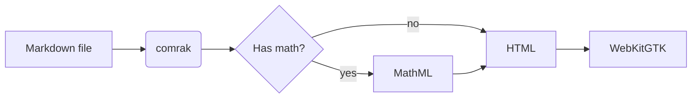
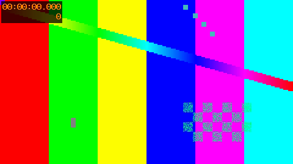

# mdreader demo

A tour of everything the reader renders. Press `g?` for the key bindings, `gO` for
the outline, and `f` to follow a link without touching the mouse.

## Text

Plain *emphasis*, **strong**, ~~strikethrough~~, `inline code`, ==highlight==,
++inserted++, H~2~O, E = mc^2^, a ||spoiler||, and an emoji :rocket:.

Autolinks work too: https://www.rust-lang.org and <mailto:someone@example.com>.

Keys like <kbd>Ctrl</kbd> + <kbd>D</kbd> are rendered from raw HTML.

## Links

- External: [The Rust Book](https://doc.rust-lang.org/book/)
- Another markdown file: [second page](other.md)
- A heading in another file: [other page, deep link](other.md#deep-section)
- In-page anchor: [jump to Media](#media)
- Wiki link: [[other|the other page]]
- Footnote reference[^1] and an inline one^[Inline footnotes work as well.].

[^1]: This is the footnote text, with a link back.

## Lists

1. First
2. Second
   - Nested bullet
   - Another
3. Third

- [x] Done task
- [ ] Open task
- [ ] Another open task

Term
: Its definition, from a description list.

Other term
: Another definition.

## Quotes and alerts

> A plain block quote,
> spanning two lines.

> [!NOTE]
> Useful information the reader should know.

> [!TIP]
> Helpful advice for doing things better.

> [!IMPORTANT]
> Key information needed to succeed.

> [!WARNING]
> Urgent information that needs attention.

> [!CAUTION]
> Advises about risks of certain actions.

## Code

```rust
use std::collections::HashMap;

/// Counts the words in a string.
fn word_count(text: &str) -> HashMap<&str, usize> {
    let mut counts = HashMap::new();
    for word in text.split_whitespace() {
        *counts.entry(word).or_insert(0) += 1;
    }
    counts
}
```

```typescript
interface Reader {
  open(path: string): Promise<void>;
  readonly zoom: number;
}

const greet = (name: string): string => `Hello, ${name}!`;
```

```toml
[package]
name = "mdreader"
edition = "2024"
```

```sh
mdreader README.md
cat notes.md | mdreader -
```

## Tables

| Motion      | Action               | Count |
| :---------- | :------------------- | ----: |
| `j` / `k`   | Scroll down / up     |   yes |
| `]]` / `[[` | Next / prev heading  |   yes |
| `gg` / `G`  | Top / bottom         |    no |

## Math

Inline math like $e^{i\pi} + 1 = 0$ sits in the text, and display math gets its own line:

$$
\int_{-\infty}^{\infty} e^{-x^2} \, dx = \sqrt{\pi}
$$

```math
\mathbf{A} = \begin{pmatrix} a & b \\ c & d \end{pmatrix}, \qquad
\det \mathbf{A} = ad - bc
```

## Diagram



## Media

An image with a caption:



A video, written with plain image syntax (``):


And one with a raw HTML tag:

<video controls width="320" src="media/clip.webm"></video>

## Collapsible

<details>
<summary>Click or hint (<code>f</code>) to expand</summary>

Hidden content with a search target: **needle-in-details**.

</details>

## Long section

Lorem ipsum dolor sit amet, consectetur adipiscing elit. Sed do eiusmod tempor
incididunt ut labore et dolore magna aliqua. Ut enim ad minim veniam, quis
nostrud exercitation ullamco laboris nisi ut aliquip ex ea commodo consequat.

Duis aute irure dolor in reprehenderit in voluptate velit esse cillum dolore eu
fugiat nulla pariatur. Excepteur sint occaecat cupidatat non proident, sunt in
culpa qui officia deserunt mollit anim id est laborum.

### Subsection one

Curabitur pretium tincidunt lacus. Nulla gravida orci a odio. Nullam varius,
turpis et commodo pharetra, est eros bibendum elit, nec luctus magna felis
sollicitudin mauris. Integer in mauris eu nibh euismod gravida.

### Subsection two

Praesent blandit laoreet nibh. Fusce convallis metus id felis luctus
adipiscing. Pellentesque egestas, neque sit amet convallis pulvinar, justo
nulla eleifend augue, ac auctor orci leo non est.

## The end

That is everything. Press `gg` to go back to the top.
